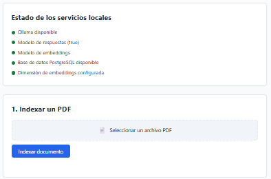
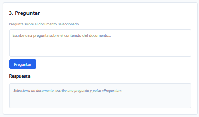

# DocuMind AI

DocuMind AI es una aplicación web pública para consultar documentos PDF mediante un agente de IA.
Este repositorio contiene el backend y el frontend en una única aplicación desplegable. Incluye la
**ingesta y extracción de texto de PDFs**, la **infraestructura local de IA** (persistencia en
PostgreSQL con pgvector y generación de embeddings con Ollama) y el **pipeline RAG completo**:
indexar un PDF, hacer preguntas sobre su contenido y obtener respuestas en español con citas a las
páginas originales.

## Requisitos

- Python 3.11.9 (compatible con Python 3.11)

Para la **infraestructura local de IA** (PostgreSQL con pgvector y Ollama) se necesita además:

- [Docker Desktop](https://docs.docker.com/desktop/setup/install/windows-install/) (Windows 11).
- [Ollama](https://ollama.com/download) para ejecutar los modelos en local.

Ambos son **opcionales para la ingesta de PDF**: solo son necesarios para la
persistencia vectorial y los embeddings descritos más abajo.

## Vista previa





## Puesta en marcha local (Windows)

### Paso 1: Situarse en el repositorio

```powershell
cd C:\Users\USUARIO\Desktop\Proyectos\AgenteDeInteligenciaDocumental
```

### Paso 2: Crear y activar un entorno virtual

```powershell
py -3.11 -m venv .venv
.\.venv\Scripts\activate
```

### Paso 3: Instalar las dependencias

```powershell
pip install -e ".[dev]"
```

### Paso 4: Configurar las variables de entorno

```powershell
copy .env.example .env
```

> Los valores por defecto son válidos para desarrollo local. Nunca subas tu archivo `.env` al repositorio.

### Paso 5: Levantar PostgreSQL + pgvector con Docker (obligatorio para el flujo RAG)

> **Importante:** Este comando se ejecuta **manualmente** desde la terminal. Docker Compose **no** se inicia automáticamente al ejecutar `uvicorn`. La primera vez se descargará la imagen `pgvector/pgvector:pg16` desde Docker Hub.

```powershell
docker compose up -d
docker compose ps            # El estado debe ser "healthy"
```

Si Docker Desktop no está en marcha, ábrelo antes de ejecutar este comando.

### Paso 6: Instalar y arrancar Ollama, descargar modelos

```powershell
ollama pull embeddinggemma
ollama pull qwen2.5:3b
```

### Paso 7: Verificar Ollama y configurar EMBEDDING_DIMENSION

```powershell
python scripts/verify_ollama.py
```

Copia el valor `EMBEDDING_DIMENSION` que muestre el script en tu archivo `.env`.

### Paso 8: Crear el esquema de base de datos (migraciones)

```powershell
python scripts/migrate.py
```

### Paso 9: Arrancar la aplicación

```powershell
uvicorn src.app.main:app --host 127.0.0.1 --port 8000 --reload
```

### Paso 10: Usar la aplicación

- **Interfaz web:** http://127.0.0.1:8000/
- **Estado de servicios:** http://127.0.0.1:8000/api/services/status
- **Health check:** http://127.0.0.1:8000/health
- **Swagger UI:** http://127.0.0.1:8000/docs

## Variables de entorno

| Variable | Descripción | Valor por defecto |
| --- | --- | --- |
| `APP_NAME` | Nombre visible de la aplicación | `DocuMind AI` |
| `ENV` | Entorno de ejecución | `dev` |
| `HOST` | Host de escucha | `127.0.0.1` |
| `PORT` | Puerto de escucha | `8000` |
| `MAX_UPLOAD_SIZE_MB` | Tamaño máximo permitido para un PDF subido, en MB | `10` |
| `POSTGRES_USER` | Usuario de PostgreSQL (también lo usa Docker Compose) | `documind` |
| `POSTGRES_PASSWORD` | Contraseña de PostgreSQL (valor de desarrollo local) | `documind` |
| `POSTGRES_DB` | Nombre de la base de datos | `documind` |
| `POSTGRES_HOST` | Host de PostgreSQL | `localhost` |
| `POSTGRES_PORT` | Puerto de PostgreSQL | `5432` |
| `POSTGRES_CONNECT_TIMEOUT` | Timeout de conexión a PostgreSQL, en segundos | `5` |
| `DATABASE_URL` | Cadena de conexión completa; si está vacía se construye con las variables `POSTGRES_*` | (vacío) |
| `OLLAMA_BASE_URL` | URL del servidor Ollama local | `http://localhost:11434` |
| `OLLAMA_LLM_MODEL` | Modelo de lenguaje | `qwen2.5:3b` |
| `OLLAMA_EMBEDDING_MODEL` | Modelo de embeddings | `embeddinggemma` |
| `OLLAMA_TIMEOUT_SECONDS` | Timeout de las llamadas a Ollama, en segundos | `120` |
| `EMBEDDING_DIMENSION` | Dimensión real de los embeddings. **Debe verificarse** antes de migrar | (vacío) |
| `EMBEDDING_VERSION` | Etiqueta de versión guardada junto a cada embedding | `1` |
| `CHUNK_SIZE_CHARS` | Tamaño máximo de cada fragmento, en caracteres | `900` |
| `CHUNK_OVERLAP_CHARS` | Solape entre fragmentos consecutivos, en caracteres | `150` |
| `EMBEDDING_BATCH_SIZE` | Número de fragmentos por lote al generar embeddings | `8` |
| `RETRIEVAL_TOP_K` | Número máximo de fragmentos recuperados por pregunta | `5` |
| `RETRIEVAL_MIN_SCORE` | Umbral mínimo de similitud (coseno) para considerar un fragmento como evidencia | `0.35` |
| `MAX_CONTEXT_CHARS` | Máximo de caracteres de contexto enviados al modelo | `6000` |
| `MAX_QUESTION_CHARS` | Longitud máxima de una pregunta | `1000` |

> `POSTGRES_PASSWORD=documind` es un valor de desarrollo local, no una credencial real.
> Nunca subas tu archivo `.env` al repositorio.

## Infraestructura local de IA (PostgreSQL + pgvector + Ollama)

Esta parte permite ejecutar todo el sistema **en local**, sin APIs de pago ni claves de
proveedores. Todavía **no** incluye la cadena de preguntas y respuestas: solo prepara los cimientos
(almacenamiento de documentos y fragmentos con embeddings, y generación de embeddings).

### Arquitectura local

```
┌──────────────┐   HTTP    ┌───────────────┐   SQL    ┌────────────────────────┐
│  FastAPI     │──────────▶│    Ollama     │          │  PostgreSQL + pgvector │
│  (src/app)   │           │  :11434       │          │  (contenedor Docker)   │
│              │─────────────────────────────────────▶│  :5432 (solo localhost)│
└──────────────┘           └───────────────┘          └────────────────────────┘
      │                                                          ▲
      │  scripts/migrate.py (migraciones .sql versionadas)       │
      └──────────────────────────────────────────────────────────┘
```

- **Ollama** genera embeddings (`embeddinggemma`) y, en el futuro, respuestas (`qwen2.5:3b`).
- **PostgreSQL + pgvector** guarda documentos y fragmentos con sus vectores.
- Los **PDF originales no se persisten**: solo se guardan metadatos y el texto extraído.

### 1. Iniciar PostgreSQL

```powershell
copy .env.example .env
docker compose up -d
docker compose ps            # el estado debe ser "healthy"
```

El contenedor usa la imagen `pgvector/pgvector:pg16`, guarda los datos en un volumen con nombre
(`documind_pgdata`) y publica el puerto **solo en `127.0.0.1`**.

Detener y eliminar:

```powershell
docker compose stop          # detiene sin borrar datos
docker compose down          # elimina el contenedor, conserva el volumen
docker compose down -v       # elimina también los datos (reconstrucción desde cero)
```

> Si `docker` no está en el `PATH`, usa la ruta completa, por ejemplo:
> `& "$env:LOCALAPPDATA\Programs\DockerDesktop\resources\bin\docker.exe" compose up -d`.

### 2. Verificar Ollama y la dimensión de los embeddings

```powershell
python scripts/verify_ollama.py
```

El script comprueba que Ollama responde, que los modelos están descargados y **mide la dimensión
real** del modelo de embeddings. Copia el valor en `EMBEDDING_DIMENSION` de tu `.env`.

Los modelos **no se descargan automáticamente**; hay que hacerlo a mano cuando estés preparado:

```powershell
ollama pull embeddinggemma     # https://ollama.com/library/embeddinggemma
ollama pull qwen2.5:3b         # https://ollama.com/library/qwen2.5
```

Revisa las **licencias y condiciones de uso** de cada modelo en sus páginas oficiales antes de
usarlos.

### 3. Crear el esquema (migraciones)

```powershell
python scripts/migrate.py
```

- Las migraciones son archivos `.sql` versionados en `migrations/`, aplicados una sola vez y
  registrados con su *checksum* en la tabla `schema_migrations`.
- La columna vectorial se declara como `vector({{embedding_dim}})`, donde la dimensión proviene de
  `EMBEDDING_DIMENSION`. **El runner se niega a migrar si esa variable no está definida**, de modo
  que nunca se crea el esquema con una dimensión inventada.

#### Reconstruir la base de datos desde cero

```powershell
docker compose down -v       # borra el volumen de datos
docker compose up -d         # contenedor nuevo y vacío
python scripts/migrate.py    # vuelve a crear el esquema
```

#### Cambiar de modelo o de dimensión (reindexado)

Los vectores de modelos distintos **nunca se comparan**: cada fragmento guarda su
`embedding_model`, `embedding_dim` y `embedding_version`, y las consultas filtran por modelo y
dimensión. Si cambias de modelo o de dimensión:

1. Verifica la nueva dimensión con `python scripts/verify_ollama.py` y actualiza
   `OLLAMA_EMBEDDING_MODEL` y `EMBEDDING_DIMENSION`.
2. Crea una migración nueva que ajuste la columna `embedding` a la nueva dimensión.
3. **Regenera** los embeddings de todos los fragmentos con el nuevo modelo antes de consultar.

Mientras no se regeneren, los vectores antiguos quedan aislados por el filtro de modelo/dimensión.

### 4. Comprobar la conexión con Ollama

```powershell
curl.exe http://localhost:11434/api/version
curl.exe http://localhost:11434/api/tags
```


## Pipeline RAG: indexar, preguntar y citar

Este flujo permite cargar un PDF, indexar su contenido, hacer preguntas y obtener respuestas
**fundamentadas en el propio documento**, con citas a la página de origen. Todo se ejecuta en local
con Ollama y PostgreSQL + pgvector; **no se envían documentos a Internet**.

### Cómo funciona

```
PDF ──▶ extracción de texto (pypdf, por página)
     ──▶ fragmentación (chunks con solape, conservando página y posición)
     ──▶ embeddings por lotes pequeños (Ollama: embeddinggemma)
     ──▶ almacenamiento en PostgreSQL + pgvector (transacción única)
                                    │
pregunta ──▶ embedding ──▶ búsqueda por similitud (filtrando modelo y dimensión)
     ──▶ umbral de relevancia ──▶ prompt en español ──▶ qwen2.5:3b
     ──▶ respuesta + citas verificables, o abstención explícita
```

Puntos clave del diseño:

- **Reindexado idempotente.** Un documento se identifica por el `sha256` de su contenido. Si ya
  estaba indexado, se reemplazan sus fragmentos del mismo modelo de embeddings en lugar de
  duplicarlos. `replace_chunks` borra e inserta dentro de una sola transacción.
- **Sin vectores incompatibles.** Cada fragmento guarda `embedding_model`, `embedding_dim` y
  `embedding_version`; toda búsqueda filtra por modelo y dimensión, de modo que nunca se comparan
  vectores de modelos distintos.
- **Filtrado por documento.** La recuperación puede restringirse a uno o varios documentos
  (`document_ids`), así no se devuelven fragmentos fuera del contexto solicitado.
- **Citas trazables.** Las citas se reconstruyen **a partir de los fragmentos recuperados**, nunca a
  partir del texto que genera el modelo. El modelo no puede inventar páginas ni documentos.
- **Abstención conservadora.** Si no hay fragmentos recuperados no se genera ninguna respuesta
  factual; si ningún fragmento supera el umbral de relevancia, o si el modelo no puede responder con
  la evidencia disponible, el sistema lo dice explícitamente en lugar de especular.
- **Privacidad.** Los PDF originales **no se persisten**: se procesan en memoria. Solo se guardan
  metadatos del documento y el texto de los fragmentos. Por defecto no se registra el contenido de
  los documentos ni las preguntas.

> **El umbral `RETRIEVAL_MIN_SCORE` (0,35 por defecto) es una heurística inicial, no una garantía de
> veracidad.** Debe calibrarse con el conjunto de evaluación de `demo/evaluation.json`. Una respuesta
> marcada como `grounded=true` significa que se apoyó en evidencia recuperada, no que sea correcta.

### Puesta en marcha

Con PostgreSQL y Ollama ya en marcha y el esquema migrado (secciones anteriores):

```powershell
python scripts/verify_ollama.py   # confirma los modelos y copia EMBEDDING_DIMENSION al .env
python scripts/migrate.py         # crea el esquema (si no lo hiciste antes)
uvicorn src.app.main:app --host 127.0.0.1 --port 8000 --reload
```

Abre http://127.0.0.1:8000/ y usa la interfaz en tres pasos: **indexar**, **seleccionar el
documento** y **preguntar**. La página muestra el estado de los servicios locales y las citas por
página de cada respuesta.

### Endpoints de RAG

#### `POST /api/documents/index`

Indexa un PDF: valida, extrae, fragmenta, genera embeddings y guarda todo de una vez.

- **Petición:** `multipart/form-data` con el campo `file` (el PDF).
- **Respuesta (`200`):**

```json
{
  "document": {
    "id": "0b0e6a1e-...-...",
    "name": "informe.pdf",
    "page_count": 4,
    "created_at": "2026-10-20T12:00:00Z",
    "chunk_count": 12
  },
  "chunk_count": 12,
  "already_indexed": false
}
```

`already_indexed` es `true` cuando el mismo contenido ya estaba indexado y se reemplazó.

#### `GET /api/documents`

Lista los documentos indexados con su número de páginas y de fragmentos.

#### `POST /api/documents/ask`

Responde a una pregunta usando solo la evidencia recuperada.

- **Petición:**

```json
{
  "question": "¿Qué planeta es el más grande del Sistema Solar?",
  "document_ids": ["0b0e6a1e-...-..."],
  "top_k": 5
}
```

`document_ids` y `top_k` son opcionales; si se omiten, se busca en todos los documentos con el `top_k`
configurado.

- **Respuesta (`200`), respuesta fundamentada:**

```json
{
  "answer": "Júpiter es el planeta más grande del Sistema Solar [1].",
  "citations": [
    {
      "document_id": "0b0e6a1e-...-...",
      "page_number": 3,
      "chunk_uid": "p3-c1",
      "excerpt": "Júpiter es el planeta más grande...",
      "score": 0.83
    }
  ],
  "grounded": true,
  "abstained": false,
  "reason": null
}
```

- **Respuesta (`200`), abstención:**

```json
{
  "answer": "No he encontrado evidencia suficiente en los documentos indexados para responder a esa pregunta.",
  "citations": [],
  "grounded": false,
  "abstained": true,
  "reason": "no_evidence"
}
```

#### `GET /api/services/status`

Indica si Ollama, sus modelos y la base de datos están disponibles, y si `EMBEDDING_DIMENSION`
está configurada. Útil para diagnosticar antes de indexar o preguntar.

### Códigos de error de RAG

| Situación | Código HTTP |
| --- | --- |
| PDF inválido, vacío, corrupto o sin texto extraíble | `400` / `422` (los mismos que la ingesta) |
| El PDF supera `MAX_UPLOAD_SIZE_MB` | `413 Content Too Large` |
| `EMBEDDING_DIMENSION` no configurada, o servicio no disponible | `503 Service Unavailable` |
| Ollama no responde o no puede generar embeddings/respuesta | `503 Service Unavailable` |
| Pregunta vacía | `400 Bad Request` |
| Pregunta demasiado larga | `413 Content Too Large` |
| Documento indicado no encontrado | `404 Not Found` |
| No hay documentos indexados sobre los que preguntar | `409 Conflict` |

### Ejemplos con `curl`

```powershell
# Indexar el documento de demostración
curl.exe -X POST "http://127.0.0.1:8000/api/documents/index" -F "file=@demo\document.pdf"

# Listar documentos indexados
curl.exe "http://127.0.0.1:8000/api/documents"

# Preguntar (sin document_ids, busca en todos)
curl.exe -X POST "http://127.0.0.1:8000/api/documents/ask" `
  -H "Content-Type: application/json" `
  -d "{\"question\": \"¿Cuál es la edad aproximada del Sistema Solar?\"}"

# Estado de los servicios locales
curl.exe "http://127.0.0.1:8000/api/services/status"
```

### Rendimiento

- Los embeddings se generan **por lotes pequeños** (`EMBEDDING_BATCH_SIZE`, 8 por defecto) para
  limitar el uso de memoria.
- El contexto enviado al modelo está acotado por `MAX_CONTEXT_CHARS` y el número de fragmentos por
  `RETRIEVAL_TOP_K`.
- Para 16 GB de RAM y gráficos integrados, `qwen2.5:3b` y `embeddinggemma` caben con holgura, pero la
  generación será lenta en CPU. Evita mantener ambos modelos cargados a la vez si la memoria es justa
  (Ollama los descarga por inactividad con `OLLAMA_KEEP_ALIVE`).

## Ingesta de PDF: API

La aplicación expone un endpoint que recibe un archivo PDF, valida el archivo y extrae su texto
página por página. El archivo se procesa **en memoria** y **nunca se guarda en disco**.

### `POST /api/documents/upload`

- **Cuerpo de la petición:** `multipart/form-data` con el campo `file` (el PDF).
- **Respuesta correcta (`200`):** un JSON tipado con el nombre del documento, el número de páginas y
  el texto extraído por página.

```json
{
  "document_name": "informe.pdf",
  "page_count": 2,
  "pages": [
    { "page_number": 1, "text": "Texto de la primera página..." },
    { "page_number": 2, "text": "Texto de la segunda página..." }
  ]
}
```

### Validaciones y códigos de error

| Situación | Código HTTP |
| --- | --- |
| El archivo no es un PDF | `400 Bad Request` |
| El archivo está vacío | `400 Bad Request` |
| El PDF está corrupto, mal formado o cifrado | `400 Bad Request` |
| El archivo supera `MAX_UPLOAD_SIZE_MB` | `413 Content Too Large` |
| El PDF no contiene texto extraíble | `422 Unprocessable Content` |
| Error inesperado durante la extracción | `422 Unprocessable Content` |
| Falta el campo `file` | `422 Unprocessable Content` |

### Ejemplo de uso

```powershell
curl.exe -X POST "http://127.0.0.1:8000/api/documents/upload" -F "file=@C:\ruta\a\informe.pdf"
```

También puedes probarlo desde la documentación interactiva en http://127.0.0.1:8000/docs.

## Demostración y evaluación

El directorio [`demo/`](demo/) contiene un documento de ejemplo reproducible y el conjunto de
preguntas de evaluación que usa el pipeline RAG:

- `demo/document.txt` — fuente de texto del documento (contenido original y propio sobre el Sistema
  Solar, con datos públicos y estables).
- `demo/document.pdf` — PDF de demostración (4 páginas), generado de forma determinista.
- `demo/evaluation.json` — 8 preguntas con respuesta esperada, página y sección de origen.
- `demo/README.md` — guía detallada en español.

Regenerar el PDF a partir de la fuente:

```powershell
python scripts/generate_demo_pdf.py
```

Subir el documento de demostración al endpoint de ingesta (solo extrae el texto):

```powershell
curl.exe -X POST "http://127.0.0.1:8000/api/documents/upload" -F "file=@demo\document.pdf"
```

Indexarlo para poder preguntar sobre él:

```powershell
curl.exe -X POST "http://127.0.0.1:8000/api/documents/index" -F "file=@demo\document.pdf"
```

Evaluación automática del pipeline sobre este documento (páginas correctas y abstención):

```powershell
$env:RUN_DB_TESTS = "1"; $env:RUN_OLLAMA_TESTS = "1"
pytest tests/integration/test_rag_evaluation.py -q
```

## Desarrollo

Ejecutar las pruebas (unitarias; las de integración se omiten por defecto):

```powershell
pytest -q
```

Ejecutar las pruebas de integración contra PostgreSQL (requiere el contenedor en marcha y el
esquema migrado):

```powershell
$env:RUN_DB_TESTS = "1"; pytest tests/integration -q
```

Ejecutar la prueba de integración opcional contra Ollama real (requiere un Ollama funcional y los
modelos descargados):

```powershell
$env:RUN_OLLAMA_TESTS = "1"; pytest tests/integration -q
```

Ejecutar **todo** el pipeline de extremo a extremo sobre el documento de demostración (requiere
PostgreSQL **y** Ollama con los modelos descargados). Comprueba que las preguntas conocidas
recuperan la página esperada y que una pregunta sin respuesta produce una abstención:

```powershell
$env:RUN_DB_TESTS = "1"; $env:RUN_OLLAMA_TESTS = "1"
pytest tests/integration/test_rag_evaluation.py -q
```

Las pruebas unitarias de `chunking`, `indexing`, `retrieval`, `rag` y los endpoints de RAG se
ejecutan **sin descargar modelos ni necesitar servicios**: usan dobles de prueba deterministas.

Comprobar el formato y el linter:

```powershell
ruff format --check .
ruff check .
```

## Despliegue (Render)

La aplicación está preparada para ejecutarse en Render. Usa el siguiente comando:

```bash
uvicorn src.app.main:app --host 0.0.0.0 --port $PORT
```

La aplicación lee el puerto desde la variable de entorno `PORT` (a través de la configuración).

## Arquitectura

- `src/app/api/` — routers de FastAPI (`health`, `documents`, `rag`).
- `src/app/services/` — lógica de negocio independiente del HTTP: `pdf_ingestion`, `ollama`,
  `embeddings`, `chunking`, `indexing`, `retrieval` y `rag`.
- `src/app/db/` — acceso a datos: `connection`, `migrations` (runner versionado) y `repositories`
  (documentos, fragmentos y búsqueda por similitud).
- `src/app/schemas/` — modelos Pydantic del API (`document`, `rag`) y dataclasses internas (`chunk`).
- `src/app/config/` — configuración de la aplicación (`settings`).
- `src/app/templates/` y `src/app/static/` — interfaz web (HTML, CSS y JavaScript).
- `migrations/` — migraciones SQL versionadas.
- `compose.yaml` — PostgreSQL + pgvector para desarrollo local.
- `demo/` — documento de demostración y conjunto de preguntas de evaluación.
- `scripts/` — utilidades de desarrollo (`generate_demo_pdf`, `migrate`, `verify_ollama`).

## Problemas frecuentes

- **`docker` no se reconoce como comando.** Docker Desktop no añadió su CLI al `PATH`. Usa la ruta
  completa: `& "$env:LOCALAPPDATA\Programs\DockerDesktop\resources\bin\docker.exe" compose up -d`.
- **`error getting credentials ... docker-credential-desktop`.** Añade temporalmente el directorio
  `...\DockerDesktop\resources\bin` al `PATH` antes de ejecutar `docker`.
- **La conexión a PostgreSQL se queda colgada con `localhost`.** Ocurre por la resolución de
  direcciones en algunos equipos; el proyecto aplica `POSTGRES_CONNECT_TIMEOUT` (por defecto 5 s).
  Si aun así falla, usa `POSTGRES_HOST=127.0.0.1` o un `DATABASE_URL` explícito.
- **Ollama responde pero falla al ejecutar un modelo** (`llama-server binary not found`). La
  instalación de Ollama está incompleta: reinstálala desde la página oficial. `verify_ollama.py`
  avisará y, como respaldo, leerá la dimensión de los metadatos GGUF del modelo ya descargado.
- **`EMBEDDING_DIMENSION` vacío.** Es intencional: ejecuta `python scripts/verify_ollama.py` y
  copia el valor antes de migrar.

## Limitaciones de rendimiento

- Equipos con gráficos integrados ejecutan los modelos en **CPU**; `qwen2.5:3b` es pequeño
  precisamente para eso, pero la generación será lenta.
- Evita tener cargados a la vez el modelo de lenguaje y el de embeddings si la memoria es justa
  (Ollama los descarga por inactividad con `OLLAMA_KEEP_ALIVE`).
- La búsqueda por similitud usa un índice **HNSW** con distancia coseno, adecuado para colecciones
  pequeñas y medianas; para volúmenes muy grandes habría que revisar el índice y los recursos.

## Notas y limitaciones

- Está implementado el **pipeline RAG completo**: ingesta y extracción de PDFs, fragmentación,
  generación de embeddings, búsqueda por similitud, generación de respuestas en español con citas por
  página y abstención cuando no hay evidencia suficiente.
- **No hay LangGraph** todavía: el flujo es una secuencia de servicios explícita y testeable. Se
  podría añadir un grafo si la orquestación se complica.
- El **umbral `RETRIEVAL_MIN_SCORE` es una heurística**, no una garantía de veracidad. Está pensado
  para calibrarse con `demo/evaluation.json`; los resultados reales de esa evaluación se describen en
  la prueba `tests/integration/test_rag_evaluation.py`.
- La **calidad de las respuestas depende del modelo local** (`qwen2.5:3b`, pequeño y apto para CPU);
  puede ser más débil que modelos grandes. Las citas siempre proceden de los fragmentos recuperados,
  pero conviene **verificarlas**.
- Los PDFs subidos **no se persisten**: se procesan en memoria y se descartan. La base de datos
  guarda solo metadatos del documento y el texto de sus fragmentos.
- Todavía **no** hay autenticación ni cuotas: la aplicación está pensada para uso local o de
  demostración.
- Las pruebas unitarias no requieren servicios; las de integración y la evaluación completa requieren
  PostgreSQL + pgvector y Ollama con los modelos descargados.
- Ningún contenido del documento se ejecuta: el texto se extrae con `pypdf` y se trata como contenido
  no confiable, nunca como instrucciones para el modelo.
